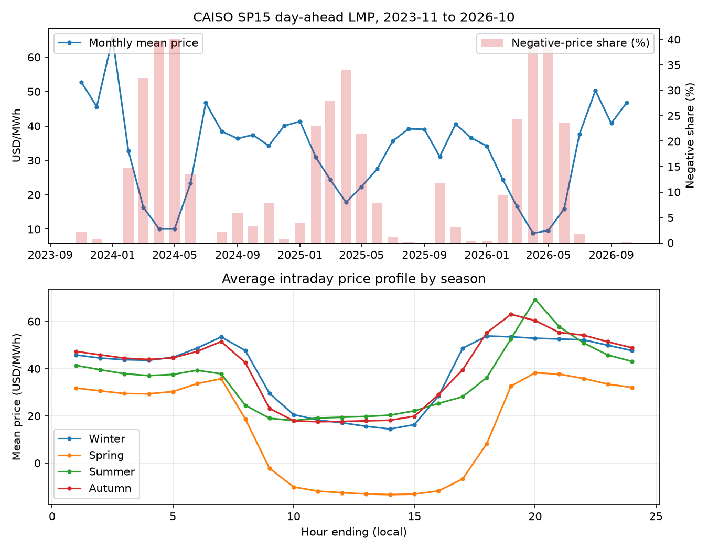

# 电价预测方案（线上组 · CAISO SP15 日前市场）

> 版本：2026-11-03 ｜ 依据：《全国"AI+电力市场"应用大赛参赛手册》p01–p24 + 本仓库 2023-11-01～2026-10-31 的 CAISO 实际数据实测
> 标记约定：**[已验证-计算]** 有本仓库脚本实测支持；**[已证]** 有数学依据；**[解读-未验证]** 为推断。

---

## 0. 结论先行

1. **比赛就是"CAISO SP15 日前 24 点 + 日 RMSE + 相对评分"**：2026-11-23～12-06 共 14 天，每天北京时间 02:00（加州 D-1 日 10:00）前提交次日 24 个价格。手册中评分公式印作 `0.60+…`，但同页文字写"等于均值时为 60 分"，按 **60 分**理解 [解读-未验证]。
2. **你的数据里，naive（昨日同时刻价）强得离谱**：全样本 MAE 6.92 / RMSE 12.54；近 12 个月按日 RMSE 中位数只有 5.84 [已验证-计算]。任何模型不先打败它就没有意义。
3. **两段历史冬季窗口（11-23～12-06）实测**：naive 日均 RMSE 7.91 / 7.99；线性+GBDT 简单平均降到 **6.94 / 5.88**，且最差单日从 22.0/19.0 降到 17.0/11.0 [已验证-计算]。**集成的价值主要在于压住最差的那一天**，而不是把平均值再压低一点。
4. **这个窗口真正的风险不是尖峰，而是"平常日 + 假日"**：近三年 11-23～12-06 的最高价只有 63.8～85.7 美元/MWh [已验证-计算]，真正的尖峰在 7–9 月；但 2026-11-26 是感恩节，2023 年感恩节均价比前一周低 32%，2024 年"黑色星期五"是集成模型回测里误差最大的那天（RMSE 17.0）[已验证-计算]。
5. **技术路线**：信息集硬切（10:00 前可得）→ 基线（naive/LEAR）→ 主模型（多任务组 Lasso + LightGBM + Ridge）→ 简单平均集成 → 尾部与假日后处理 → 每日滚动重训。**不要**在 14 天里追求复杂模型；本仓库证据显示模型排名会在两个窗口之间翻转。

---

## 1. 赛制事实与它带来的三个硬约束

| 项目 | 内容（手册页码） |
|---|---|
| 预测对象 | CAISO **SP15** 交易枢纽（TH_SP15_GEN-APND）日前电价，24 个整点 |
| 比赛期 | 2026-11-23～12-06（北京时间），共 14 个运行日 |
| 提交 | 每天一次，北京时间 D 日 02:00 = 加州 D-1 日 10:00 封存 |
| 指标 | 日 RMSE：`RMSE_d = sqrt(mean_t (λ̂-λ)^2)` |
| 得分 | `s_d = min(100, max(0, 60 + s1·(μ-RMSE_d)/σ))`，σ、μ 为本组当日各队 RMSE 的均值/标准差；`S = mean(s_d)` |
| 数据 | 自行从 CAISO OASIS 取数；未发现"禁用外部数据"条款，但须遵守 CAISO 使用条款 |

**约束一：RMSE ⇒ 目标函数是条件均值，不是中位数。** 用 L1/分位数中位数训练会系统性低估右偏的尖峰，RMSE 反而更差。若要概率预测，只能作为集成的一项，不能直接替代点预测。

**约束二：相对评分 ⇒ 方差比均值更致命。** 得分对 RMSE 是仿射的，但有 0/100 截断：一天崩盘最多丢 60 分（折合 final score 4.3 分），而一天超常最多多拿 40 分。**在 14 天里，一次事故几乎无法用其他天补回来。**

**约束三：14 天 ⇒ 不能靠"调参调出来"。** 14 个样本的日均 RMSE 标准误很大；任何在历史上好 0.3 的模型都可能是噪声。**选择"平均好 + 最差日不崩"的方案，而不是"历史上最好"的方案。**

---

## 2. 数据画像：这个市场长什么样

数据：2023-11-01～2026-10-31，26,304 条小时级 SP15 日前总电价（LMP_TYPE=LMP），1,096 天 [已验证-计算]。

| 统计量 | 数值 (USD/MWh) |
|---|---|
| 均值 / 中位数 | 32.31 / 35.22 |
| 标准差 | 26.55 |
| 5% / 25% / 75% / 95% / 99% | -11.14 / 19.63 / 46.36 / 64.69 / 91.46 |
| 最小 / 最大 | -67.08 / 614.42 |
| 负电价占比 | **12.07%**（3,174 小时） |
| >100 / >200 占比 | 0.75% / 0.20% |

三个结构性事实：

- **负电价是季节性的，不是随机的。** 4 月负电价占比 34%～40%，而 7–9 月接近 0；机制上通常归因于午间光伏出力与机组最小出力约束 [解读-未验证]。比赛窗口（11 月底）负电价概率很低（2023-11 为 2.1%，2024-11 为 7.8%，2025-11 为 3.1%）[已验证-计算]。
- **价格与净负荷强相关，与光伏负相关。** Pearson：净负荷 0.617、净负荷/负荷比 0.662、光伏 -0.570、负荷 0.525、风电 0.034 [已验证-计算]。**风电与价格的线性相关几乎为 0**，线性模型里不必给它太多权重（非线性/极端时段另说）。
- **日内形态是"晚峰 + 午间塌陷"双结构。** 冬季晚峰在 HE19–20，春季午间 HE10–15 均价为负。用单一"小时哑变量"不够，必须让模型看到"当天净负荷曲线形状"。

**误差集中度（naive，近 12 个月）**：最差的 5 天贡献了 25.4% 的平方误差，最差 10 天贡献 33.9%，单日最高日均 RMSE 49.5 [已验证-计算]。这直接说明：**RMSE 战场在少数几天**。

---

## 3. 信息集：10:00 之前到底知道什么

| 特征 | 来源 | 截止时可得？ | 说明 |
|---|---|---|---|
| D-1 及更早的 24 点日前价 | OASIS PRC_LMP | ✅（D-2 13:00 发布） | 最强特征 |
| D 日负荷预测（CAISO/SCE/SDGE TAC） | OASIS SLD_FCST | ✅（约 9:00 发布） | 三个口径都要 |
| D 日 SP15 光伏/风电预测 | OASIS SLD_REN_FCST | ✅（约 8:45 发布） | 注意 3 月有已知缺日 |
| 日历（星期、假日、月） | 自建 | ✅ | 感恩节必须显式处理 |
| 气温、气价、检修、水电 | Open-Meteo / EIA / CAISO | ✅ | 可选，冬季边际价值高 |

**必须警惕的三件事**：
1. **不能用 D 日的实际价格、实际负荷**——那是未来信息。本仓库 `data/caiso_collection_notes.md` 已明确"历史可用时间未验证"，做特征时必须自己按发布时刻硬切。
2. **CAISO 会修订已发布数据**——每天重拉最近 7 天并覆盖，不要只增量追加。
3. **夏令时**：比赛窗口内没有 DST 切换，但历史训练数据有 23/25 小时日；按 `OPR_DT+OPR_HR` 对齐，别按行号 shift。

---

## 4. 建模路线：四层，从便宜到贵

### L0 基线（必须做，且要留作 fallback）
- **Naive**：`p(d,h) = p(d-1,h)`
- **Seasonal naive**：`p(d,h) = p(d-7,h)`
- **LEAR**：24 个独立 Lasso，特征为前 1/2/3/7 日 24 点价格 + 外生 + 星期哑变量

> 本仓库实测：naive 全样本 MAE 6.92 / RMSE 12.54；近 6 个月 6.48 / 10.48 [已验证-计算]。基线不达标就别谈模型。

### L1 主模型（三件套，互相纠错）
1. **多任务组 Lasso（CING-LEAR 的最小实现）**：把 24 个时刻当 24 个输出，特征按"一个特征 × 24 小时"成组，组稀疏惩罚 `Ω(B)=Σ_j ||b_j||_2`。sklearn `MultiTaskLasso` 即可，成本极低。
2. **LightGBM（长表）**：每个 (日,时) 一行，特征含同时刻滞后、邻接小时、净负荷、日历。
3. **Ridge（长表或 24 输出）**：作为线性锚，防止 GBDT 在样本外乱跑。

> **本仓库的一个实证**：在 268 维日级设计上，组 Lasso（标准化、alpha=0.1）最终只保留了 **24 个组——恰好是"昨日 24 点价格"这一组特征**；它的预测与实际的相关系数 0.886，高于 naive 的 0.758 [已验证-计算]。这印证了 Group Lasso 论文的核心论点（跨小时依赖是真实的）；至于"冬季窗口外生变量贡献小"，只是该设定下的现象 [解读-未验证]。

### L2 尾部与体制（按指标定制）
- **假日**：显式假日哑变量 + "距假日天数"；感恩节单独标记。2023 年感恩节均价比前一周低 32% [已验证-计算]。
- **尖峰**：用"净负荷分位数 + 备用紧张度"做门控，或训练一个"高价日"分类器，对高概率日**只上调晚峰 2–4 个小时**，不要全天盲目加价。
- **负电价**：比赛窗口概率低，但若预测值 <0，不要强行截断到 0——CAISO 允许负价，截断会引入偏差。

### L3 集成与后处理
- **简单平均优先**：`0.5·Ridge + 0.5·LightGBM`，或三模型等权。两段冬季窗口里，简单平均都优于任一单模型 [已验证-计算]。
- **收缩到 naive**：`p = w·p_model + (1-w)·p_naive`，w 取 0.6–0.8 [解读-未验证，待回测]。
- **硬护栏**：裁剪到 `[近30日最低-30, 近30日最高+50]`；禁止 NaN；固定 24 点、两位小数。

---

## 5. 实测证据（本仓库脚本，可复现）

### 5.1 全年滚动（2025-11～2026-10，按月重训，n=8,758）

| 模型 | MAE | RMSE | 说明 |
|---|---|---|---|
| naive | 5.884 | 9.206 | 基准 |
| Ridge（滞后+外生） | 5.694 | **8.253** | RMSE 最好 |
| LightGBM（滞后+外生） | 5.804 | 9.141 | 均值好于 naive，尾部差 |
| LightGBM（加跨小时特征） | **5.574** | 9.158 | MAE 最好，RMSE 不变 |

> 解读：**跨小时特征把 MAE 压低 4%，但对 RMSE 没帮助**；Ridge 的 RMSE 优势来自高价时段（>80 美元的 MAE 从 26.2 降到 21.3）[已验证-计算]。

### 5.2 两段历史"同款"冬季窗口（11-23～12-06，训练只用窗口之前的数据）

| 模型 | 2024 窗口 日均RMSE / 最差日 | 2025 窗口 日均RMSE / 最差日 |
|---|---|---|
| naive | 7.91 / 22.02 | 7.99 / 19.01 |
| Ridge | 7.20 / 14.49 | 6.35 / 12.32 |
| LightGBM | 7.37 / 19.52 | 5.97 / 11.52 |
| **等权集成** | **6.94 / 16.96** | **5.88 / 10.98** |

> 三个结论 [已验证-计算]：
> 1. 所有像样的模型都比 naive 好 7%–26%；
> 2. **单模型排名在两个窗口之间翻转**（2024 年 Ridge 好，2025 年 LightGBM 好），差异在噪声内；
> 3. **等权集成在两个窗口都优于两个成分，且最差日明显更低**——这就是"压住事故"的价值。

### 5.3 一个必须写进风险清单的现象
组 Lasso / 多任务 Lasso 的样本外表现对**标准化方式与正则强度 alpha 高度敏感**：同一份数据、同一组特征，换一个 alpha 口径，日均 RMSE 可以相差 1–2 美元/MWh [已验证-计算]。在 14 天赛制下，**这种敏感性本身就是风险**——所以它更适合作为集成的一员，而不是唯一提交模型。

---

## 6. 验证协议（比模型更重要）

1. **滚动原点**：每次只用窗口起点之前的数据训练，逐日/逐周向前推进；禁止随机 KFold。
2. **窗口与赛制同长**：用 14 天窗口的"日均 RMSE"作为选择指标，而不是全年 MAE。
3. **多窗口、看分布**：至少覆盖 2024-11-23、2025-11-23 两段 + 近两年所有 14 天窗口；报告均值、最差日、以及"崩盘日比例"。
4. **显著性**：按日聚合做 paired bootstrap（block=7 天），不要用小时级样本量假装显著。
5. **禁止用比赛窗口调参**：11-23 之后只允许修 bug，不允许改模型结构。

---

## 7. 三周执行计划（今天 2026-11-03）

| 时间 | 任务 | 产出 |
|---|---|---|
| 11/03–11/06 | 固化数据管道：OASIS 日更、修订覆盖、发布时刻表 | `scripts/fetch_daily.py`，能一条命令产出 D 日 24 点特征 |
| 11/07–11/09 | 复现 L0 基线 + 两段冬季窗口回测 | 基线表 + 回测脚本 |
| 11/10–11/13 | L1 三件套 + 集成；假日/尖峰规则 | 候选模型 3 个 + 集成 |
| 11/14–11/16 | 扩大回测：近两年所有 14 天窗口；稳健性检查 | 选择报告（均值/最差日） |
| 11/17–11/19 | 冻结模型；写"每日 02:00 前自动出数"脚本 + 人工复核清单 | `scripts/predict_and_submit.py` |
| 11/20–11/22 | 彩排 3 天：模拟取数→预测→提交→对账 | 彩排记录、值班表 |
| 11/23–12/06 | 每天 00:30 取数、01:00 出预测、01:30 人工复核、02:00 前提交 | 每日日志 |

**每天的人工复核清单**（5 分钟）：
- 24 个值是否齐全、有无 NaN/异常跳变；
- 当日是否为假日/假日前后；
- 晚峰（HE17–21）预测是否明显低于昨日同时刻（除非有明确理由）；
- 与 naive 的偏差是否超过 3 倍近 30 日波动（超了就用收缩版）。

---

## 8. 风险清单

| 风险 | 概率 | 影响 | 对策 |
|---|---|---|---|
| 取数失败/接口限流 | 中 | 无法提交 | 本地缓存最近 60 天；失败则退回 naive 提交 |
| 时区/截止时间搞错 | 中 | 当日 0 分 | 用北京时间 01:30 的硬闹钟；提前一天彩排 |
| 尖峰日全队都错，自己错更多 | 中 | 单日 0 分 | 集成 + 收缩 + 晚峰门控 |
| 感恩节/黑五 | 高 | 单日大误差 | 假日哑变量；参考 2023/2024 感恩节形态 |
| 过拟合 3 年数据 | 高 | 样本外崩 | 强正则、简单模型、集成 |
| CAISO 数据修订 | 中 | 滞后特征错 | 每日重拉最近 7 天 |

---

## 9. 四篇文献各自的位置

| 文献 | 能给你什么 | 不能给你什么 |
|---|---|---|
| **Group Lasso（CING-LEAR）** | 24 输出 + "特征×24 小时"组稀疏的建模框架；CAISO 上 RMSE 10.65、CRPS 3.93 的基准；"跨小时效应"的经验证据 | 原文没有 PICP/pinball；M、K、λ 未给出；概率部分只有高斯常数协方差 |
| **分位数回归（CAISO 情景/压力测试）** | 13 个分位点的 log-log 模型；情景构造"固定其余、扫描单变量"；负电价必须平移处理 | 无样本外回测；系数符号不自洽；单区 5 小时 |
| **Endogenous predictors** | 特征重要性的量化：lag_1h + lag_24 + MA_30d 占 SHAP 约 49%，负荷预测仅 4.3%；24h 滚动多 fold 验证协议 | 只做点预测；极端段失效；无显著性检验 |
| **Online LSTM** | "选择性更新"（验证集门控）优于每日全量重训；24 维输出；MAE+平滑项损失 | 不是迁移学习、没有集成、没有漂移检测；MAE 相对 GBR 的改进 CI 含 0 |

**共同结论**：电价预测的精度主体来自**价格自身的历史结构**（滞后、跨小时、周期），外生变量的边际贡献集中在极端时段；验证必须滚动、必须看分布、必须和 naive 比。

---

## 10. 复现方式

本报告的数字来自以下脚本（均在 `work/`）：

- `build_dataset.py`：合并 36 个月 LMP + 负荷/风光预测 → `hourly.csv.gz`
- `eda.py`：分布、负电价、季节性、naive 基线 → `eda_report.md`
- `model.py`：全年滚动回测（naive/Ridge/LightGBM/跨小时）
- `winter_bt2.py`：两段冬季窗口回测（含集成）
- `check_mtl.py`：组 Lasso 的特征选择与预测诊断
- `fig.py`：价格画像图

运行环境：Python 3.12 + pandas 3.0 + scikit-learn 1.9 + LightGBM 4.7（本机已装）。
